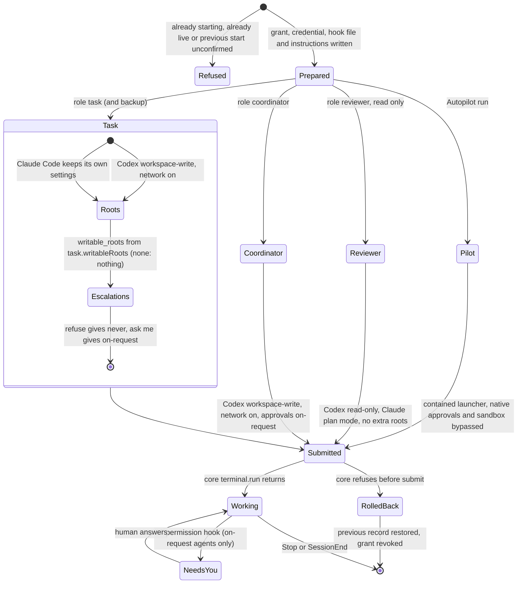

# Agent launch

How `CoreAgents.launch` (`server/core/agents.ts`) picks a native CLI's sandbox
and approvals, and how a launch settles. Settings are read at launch time, so
a change applies to new starts and restarts only.

With `refuse`, a blocked command returns an error to the agent instead of a
permission hook, so a Codex task agent does not reach Needs you through an
approval prompt; it still can through an ask card or a turn that ends
without `ready`.
