# Automation runs

How one automation run goes, from its trigger to its row in `automation list`. The runner is
`server/core/automations.ts` (`CoreAutomations.fire`); the saved definition and its last 10 runs are in
`server/automations.ts`.

```mermaid
stateDiagram-v2
    [*] --> Queued: event rule matched (run saved as queued)
    [*] --> Due: time rule due (scan every 5 s)
    [*] --> Manual: Run now / shepherdr automation run
    Queued --> Check: queue processed, automation on
    Due --> Check
    Check --> Skipped: a task it added is open and overlap is off
    Check --> Starting: no open task, or overlap on
    Manual --> Check
    Starting --> Added: task added in its space
    Starting --> Failed: add refused or errored
    Starting --> Interrupted: Shepherdr restarted mid-start
    Skipped --> [*]: row "skipped: <task> is still open"
    Added --> [*]: row with the task id
    Failed --> [*]: row with the error
    Interrupted --> [*]: row "Run interrupted; inspect tasks"
```

- **Open** means the task's workflow is not `merged` or `closed` (archived tasks still count). A task whose launch
  failed counts too: it stays in the space until someone closes it.
- A skipped timed run still advances the time cursor, so the next try is the rule's next time, not the next scan.
- A paused automation (`on: false`) reaches Check only through Run now; resuming it is safe because the first due run is checked
  against the open task like any other.
- A skipped `once` rule is over, as a run of it would be: give it a new time to try again.
- `--overlap on` on `automation add` or `edit` turns the check off for that automation.
