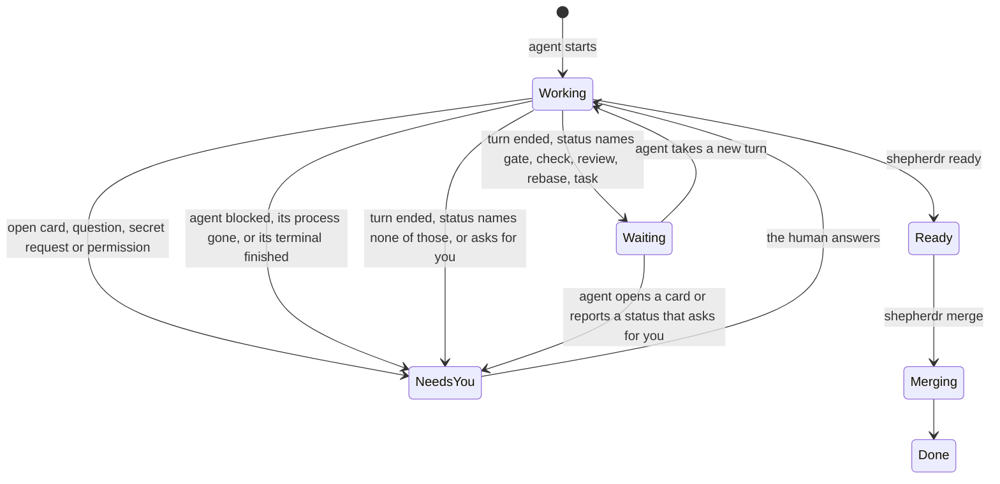

# Task status

How `CoreTasks.view` in `server/core/tasks.ts` picks a working task's dot.
Only Needs you alerts the human and counts for Notify's Needs me; Waiting
does neither.

A start error is always Needs you. Queued, To do, Ready, Merging and Done
come from the task's workflow before any of the agent's own signals.
